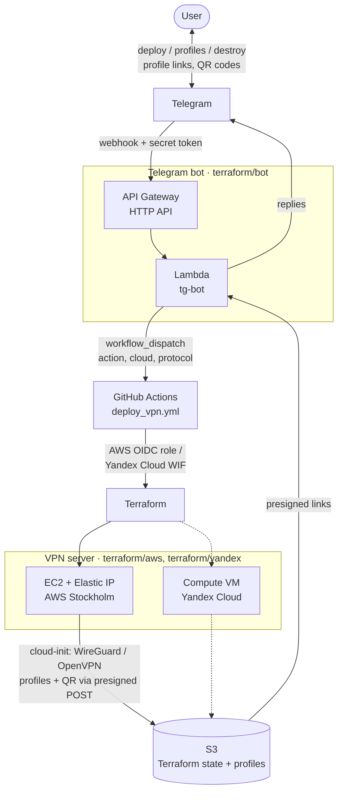

# Deploying VPN from Telegram

This project was created to demonstrate the capabilities of cloud engineering and process automation using various CI/CD and IaC tools.

By casually talking with the [Telegram chatbot](https://core.telegram.org/bots/api), the user can create his own [WireGuard](https://www.wireguard.com/) or [OpenVPN](https://openvpn.net/) server with a dedicated public IP address either in AWS Stockholm or in Yandex Cloud. When the work is done, the entire infrastructure can be automatically destroyed.

This is just an example of such an implementation that can be (and will be) endlessly improved in many ways.

<a href="url"></a>
## Tech Stack

**Cloud:** AWS, Yandex Cloud

**IaC:** Terraform

**VPN Server:** WireGuard or OpenVPN, Ubuntu 24.04 LTS, [cloud-init](https://cloud-init.io/)

**Telegram bot:** AWS Lambda (Python 3.13), AWS API Gateway (HTTP API)

**CI/CD:** GitHub Actions

Technically, the process is structured as follows:

When receiving a new message, Telegram calls a webhook configured in AWS API Gateway which launches a handler function in AWS Lambda. The webhook is protected with a secret token, and the bot only talks to allowed chat IDs. The function and the API are deployed with Terraform by GitHub Actions.

Depending on the selected action the bot will respond and launch the `deploy_vpn.yml` workflow in GitHub Actions with the target cloud and protocol. Before applying, the workflow generates a temporary presigned S3 POST that allows uploading files only under `profiles/<cloud>/`. Terraform creates the server with a static public IP and passes the bootstrap script, VPN configs and the upload credentials in the server's user data as a [cloud-init](https://cloud-init.io/) config (cloud-init is the standard first-boot initialization tool of cloud Linux images; the config is rendered by the `terraform/modules/cloud-init` module), so the server needs no cloud credentials at all. The script installs WireGuard (keys and a QR code per client) or OpenVPN (Certification Authority and certificates), configures IP forwarding and the firewall, builds client profiles and uploads them to S3. Download links (temporary S3 presigned URLs) and QR codes are sent to the user by the Telegram bot.

## Bot commands

| Menu command | Same as text | Action |
|---|---|---|
| `/deploy` | `deploy` | WireGuard server in AWS Stockholm |
| `/deploy_openvpn` | `deploy openvpn` | OpenVPN on 443/tcp in AWS, for networks where UDP is blocked |
| `/deploy_yandex` | `deploy yandex` | WireGuard server in Yandex Cloud |
| `/deploy_yandex_openvpn` | `deploy yandex openvpn` | OpenVPN on 443/tcp in Yandex Cloud |
| `/profiles` | `profiles`, `link`, `status` | Last job status, profile links and QR codes |
| `/destroy` | `destroy` | Destroy the AWS server |
| `/destroy_yandex` | `destroy yandex` | Destroy the Yandex Cloud server |

The menu is registered in Telegram by the bot deployment workflow. Menu commands cannot contain spaces, so the bot reads `_` as a space; any command also works as plain text, with or without the slash. A few extra text commands are not in the menu: `profile` (profile links only), `qr` (QR codes only, for the WireGuard mobile app) and `start` / `hi` (greeting).

WireGuard creates a profile per device (`phone` and `laptop` by default, see the `wireguard_peers` variable), since one WireGuard key cannot be used by two devices at the same time.

## Architecture



## Repository layout

| Path | What |
|---|---|
| `terraform/bootstrap` | State bucket, GitHub OIDC provider and role, applied locally (state key `bootstrap/terraform.tfstate`) |
| `terraform/aws` | VPN server in AWS (state key `terraform/terraform.tfstate`) |
| `terraform/yandex` | VPN server in Yandex Cloud (state key `terraform/yandex.tfstate`) |
| `terraform/bot` | Telegram bot: Lambda, HTTP API, IAM (state key `terraform/bot.tfstate`) |
| `terraform/modules/cloud-init` | Renders the cloud-init config (bootstrap script, VPN configs, upload credentials) shared by both clouds |
| `scripts/bootscript.sh`, `configs/` | Server bootstrap, WireGuard and OpenVPN configs |

All states are stored in the same S3 bucket; the bucket and region are passed with `-backend-config`:

```bash
terraform -chdir=terraform/aws init -backend-config="bucket=<bucket>" -backend-config="region=eu-north-1"
```

## Setup

GitHub repository variables:

| Variable | Description |
|---|---|
| `GH_ROLE` | AWS IAM role assumed via GitHub OIDC |
| `AWS_REGION` | AWS region, the same as the bucket region |
| `S3_BUCKET` | Bucket for Terraform states and client profiles |
| `TELEGRAM_ALLOWED_CHAT_IDS` | Comma-separated chat IDs allowed to use the bot |
| `YC_CLOUD_ID`, `YC_FOLDER_ID` | Yandex Cloud cloud and folder |
| `YC_SA_ID` | Yandex Cloud service account used by GitHub Actions |

GitHub repository secrets: `TELEGRAM_TOKEN`, `GH_TOKEN` (fine-grained token with `Actions: read and write` on this repository).

### Bootstrap

`terraform/bootstrap` manages what the workflows themselves depend on, so it is applied locally with admin credentials rather than by GitHub Actions:

- the S3 bucket: versioning, SSE-S3 encryption with SSE-C blocked, public access block, TLS-only bucket policy, lifecycle that expires old state versions after 90 days and old versions of deleted client profiles after 1 day;
- the GitHub OIDC provider and the `GH_ROLE` role. The role trusts only the `main` branch of this repository by GitHub's immutable OIDC subject, which includes the owner and repository IDs, so a repository recreated under the same name cannot assume it. After a rename update `github_owner` / `github_repository`;
- a least-privilege inline policy of the role: the Terraform states and their locks, `profiles/`, the VPN server in EC2, and the bot's Lambda, HTTP API, log group and IAM role;
- the permissions boundary of the bot's Lambda role. The GitHub role can write the bot role's policies only while this boundary is set, so it cannot grant itself more through the bot.

The state is kept under `bootstrap/`, out of the GitHub role's reach:

```bash
terraform -chdir=terraform/bootstrap init -backend-config="bucket=<bucket>" -backend-config="region=eu-north-1"
terraform -chdir=terraform/bootstrap apply
```

The bucket and the role were originally created by hand and are adopted with `import` blocks (`imports.tf`), so the first apply changes them in place. In a new account, create the bucket by hand first, since the state lives in it, drop the `import` blocks of the OIDC provider and the role, and set the `github_*` variables (IDs: `gh api repos/<owner>/<repo> --jq '.owner.id, .id'`).

### Yandex Cloud

GitHub Actions authenticates in Yandex Cloud with [Workload Identity Federation](https://yandex.cloud/en/docs/iam/concepts/workload-identity), no static keys are stored:

1. Create a service account with the `compute.editor` and `vpc.admin` roles on the folder.
2. Create an OIDC federation: issuer `https://token.actions.githubusercontent.com`, audience `https://github.com/<github_owner>`, JWKS `https://token.actions.githubusercontent.com/.well-known/jwks`.
3. Link the service account to the federation with the subject `repo:<github_owner>/<repository>:ref:refs/heads/main`.
4. Set `YC_SA_ID`, `YC_CLOUD_ID` and `YC_FOLDER_ID` variables in the repository.

## Versions

- [v1.0](https://github.com/eosklv/Telegram-VPN/releases/tag/v1.0) — the original version: OpenVPN in AWS only, Telegram bot deployed with Serverless Framework.
- v2.0 — WireGuard, Yandex Cloud, everything deployed with Terraform.

## Author

- [Eugeny Sokolov](https://linkedin.com/in/esklv)
