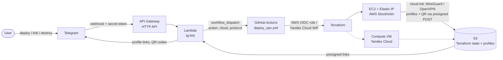

# Deploying VPN from Telegram

This project was created to demonstrate the capabilities of cloud engineering and process automation using various CI/CD and IaC tools.

By casually talking with the [Telegram chatbot](https://core.telegram.org/bots/api), the user can create his own [WireGuard](https://www.wireguard.com/) or [OpenVPN](https://openvpn.net/) server with a dedicated public IP address either in AWS Stockholm or in Yandex Cloud. When the work is done, the entire infrastructure can be automatically destroyed.

This is just an example of such an implementation that can be (and will be) endlessly improved in many ways.

<a href="url"></a>
## Tech Stack

**Cloud:** AWS, Yandex Cloud

**IaC:** Terraform

**VPN Server:** WireGuard or OpenVPN, Ubuntu 24.04 LTS, cloud-init

**Telegram bot:** AWS Lambda (Python 3.13), AWS API Gateway (HTTP API)

**CI/CD:** GitHub Actions

Technically, the process is structured as follows:

When receiving a new message, Telegram calls a webhook configured in AWS API Gateway which launches a handler function in AWS Lambda. The webhook is protected with a secret token, and the bot only talks to allowed chat IDs. The function and the API are deployed with Terraform by GitHub Actions.

Depending on the selected action the bot will respond and launch the `deploy_vpn.yml` workflow in GitHub Actions with the target cloud and protocol. Before applying, the workflow generates a temporary presigned S3 POST that allows uploading files only under `profiles/<cloud>/`. Terraform creates the server with a static public IP and passes the bootstrap script, VPN configs and the upload credentials via cloud-init, so the server needs no cloud credentials at all. The script installs WireGuard (keys and a QR code per client) or OpenVPN (Certification Authority and certificates), configures IP forwarding and the firewall, builds client profiles and uploads them to S3. Download links (temporary S3 presigned URLs) and QR codes are sent to the user by the Telegram bot.

## Bot commands

| Message | Action |
|---|---|
| `deploy` | WireGuard server in AWS Stockholm |
| `deploy yandex` | WireGuard server in Yandex Cloud |
| `deploy openvpn`, `deploy yandex openvpn` | OpenVPN on 443/tcp, for networks where UDP is blocked |
| `link`, `status` | Last job status, profile links and QR codes |
| `destroy`, `destroy yandex` | Destroy the server |

WireGuard creates a profile per device (`phone` and `laptop` by default, see the `wireguard_peers` variable), since one WireGuard key cannot be used by two devices at the same time.

## Architecture



## Repository layout

| Path | What |
|---|---|
| `terraform/aws` | VPN server in AWS (state key `terraform/terraform.tfstate`) |
| `terraform/yandex` | VPN server in Yandex Cloud (state key `terraform/yandex.tfstate`) |
| `terraform/bot` | Telegram bot: Lambda, HTTP API, IAM (state key `terraform/bot.tfstate`) |
| `terraform/modules/cloud-init` | cloud-config shared by both clouds |
| `scripts/bootscript.sh`, `configs/` | Server bootstrap, WireGuard and OpenVPN configs |

All states are stored in the same S3 bucket; the bucket and region are passed with `-backend-config`:

```bash
terraform -chdir=terraform/aws init -backend-config="bucket=<bucket>" -backend-config="region=eu-north-1"
```

## Setup

GitHub repository variables:

| Variable | Description |
|---|---|
| `GH_ROLE` | AWS IAM role assumed via GitHub OIDC |
| `AWS_REGION` | AWS region, the same as the bucket region |
| `S3_BUCKET` | Bucket for Terraform states and client profiles |
| `TELEGRAM_ALLOWED_CHAT_IDS` | Comma-separated chat IDs allowed to use the bot |
| `YC_CLOUD_ID`, `YC_FOLDER_ID` | Yandex Cloud cloud and folder |
| `YC_SA_ID` | Yandex Cloud service account used by GitHub Actions |

GitHub repository secrets: `TELEGRAM_TOKEN`, `GH_TOKEN` (fine-grained token with `Actions: read and write` on this repository).

The `GH_ROLE` role needs access to the S3 bucket, EC2, and Lambda, API Gateway, IAM and CloudWatch Logs for the bot.

### Yandex Cloud

GitHub Actions authenticates in Yandex Cloud with [Workload Identity Federation](https://yandex.cloud/en/docs/iam/concepts/workload-identity), no static keys are stored:

1. Create a service account with the `compute.editor` and `vpc.admin` roles on the folder.
2. Create an OIDC federation: issuer `https://token.actions.githubusercontent.com`, audience `https://github.com/<github_owner>`, JWKS `https://token.actions.githubusercontent.com/.well-known/jwks`.
3. Link the service account to the federation with the subject `repo:<github_owner>/vpn:ref:refs/heads/main`.
4. Set `YC_SA_ID`, `YC_CLOUD_ID` and `YC_FOLDER_ID` variables in the repository.

## Versions

- [v1.0](https://github.com/eosklv/vpn/releases/tag/v1.0) — the original version: OpenVPN in AWS only, Telegram bot deployed with Serverless Framework.
- v2.0 — WireGuard, Yandex Cloud, everything deployed with Terraform.

## Author

- [Eugeny Sokolov](https://linkedin.com/in/esklv)
